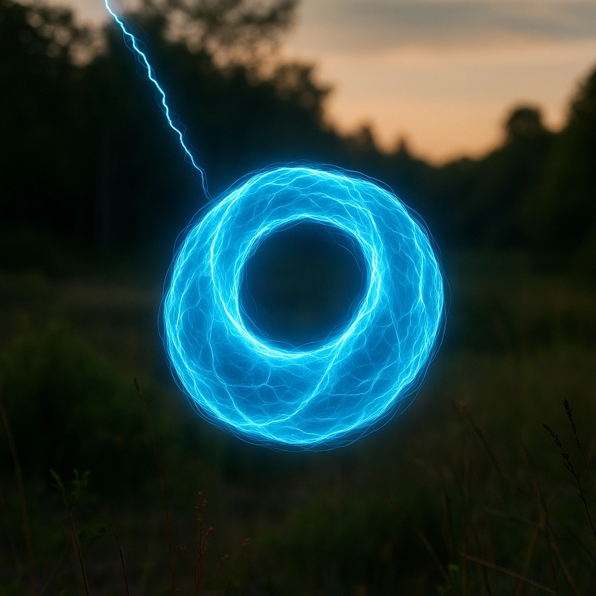

**[English Version](./README.md)**

# 霍普離子環閃電假說

**Hopfion (Ring) Lightning Hypothesis**

[](https://doi.org/10.5281/zenodo.17510337)

本假說提出：所謂的「球狀閃電」是 **Hopfion (Ring) Lightning**——一種磁力線彼此鏈結（磁螺旋度不為零）、由周圍大氣壓力約束的緊湊環形電漿結構。觀測到的圓形外觀被提出為來自透過自身光暈觀看的厚發光環面。

> **v0.8（2026-11-07）是修正版。** 一次物理重新審查發現，僅靠拓撲無法解釋長達數秒的壽命：在 v0.7 的參考溫度 ~4,200 K 下（並非量測值），空氣電漿中 10 cm 結構的電阻衰減時間為 ~10⁻⁷ s，而 5 s 的壽命需要高於銅的電導率。此問題現明列為本假說的核心未解問題，並附上修正後的公式與自洽的預測。詳見 [v0.8 變更內容](./markdown/zh-TW/hypothesis-zh-TW.md#v08-變更內容)。

> 這是一份持續更新的文件。歡迎貢獻、批判與證偽嘗試。



---

## 作者

**Kris Lai**
- Email: kriss@scallop.io
- ORCID: [0009-0000-2223-4826](https://orcid.org/0009-0000-2223-4826)
- 機構: [Scallop Labs](https://www.scallop.io/)

---

## 文件

| 文件 | 語言 | 說明 |
|------|------|------|
| [`hypothesis-en.md`](./markdown/en/hypothesis-en.md) | English | 完整英文版假說架構（Markdown） |
| [`hypothesis-zh-TW.md`](./markdown/zh-TW/hypothesis-zh-TW.md) | 繁體中文 | 完整繁體中文版假說架構 |
| [`VERIFICATION-REPORT.md`](./markdown/en/VERIFICATION-REPORT.md) | English | 科學驗證報告 |
| [`VERIFICATION-REPORT-zh-TW.md`](./markdown/zh-TW/VERIFICATION-REPORT-zh-TW.md) | 繁體中文 | 科學驗證報告（中文版） |

---

## 驗證摘要

> **v0.8 說明**：下方的 v0.7 驗證檢查了參考文獻與教科書形式，卻放過了數項物理錯誤——因次錯誤的壽命公式、不適用於物理場的螺旋度/Hopf 荷正規化、與預測磁場不一致的旋轉預測，以及「僅靠拓撲即可帶來穩定性」的宣稱。這些已在 v0.8 中修正；重新審查見[驗證報告](./markdown/zh-TW/VERIFICATION-REPORT-zh-TW.md) §0，數值檢驗可用 [`analysis/`](./analysis/) 中的腳本重現。

v0.7 驗證（2026-03-12）的結果如下：

| 類別 | 驗證結果 | 方法 |
|------|---------|------|
| 物理方程（MHD） | 3/3 | 教科書交叉比對 |
| 拓撲宣稱 | 5/5 | 同行評審文獻 |
| 觀測宣稱 | 6/6 | 球狀閃電調查數據 |
| 形成機制宣稱 | 4/4 | 大氣物理文獻 |
| Hopfion 實驗類比 | 4/4 | 凝態物質/光學文獻 |
| DOI 引用 | 30/30 | CrossRef REST API |
| **驗證總數** | **52** | |

> 完整方法論、逐項驗證表格及 DOI 審計結果詳見[驗證報告](./markdown/zh-TW/VERIFICATION-REPORT-zh-TW.md)。

---

## 架構總覽

- **第0章　序言** — 從閃電到環狀能量體
- **第1章　Ball Lightning 的再定義** — 被誤解的外觀、氣泡環類比、核心觀點
- **第2章　Hopfion (Ring) 結構** — 螺旋度與 Hopf 不變量之別；穩定性要素（大氣約束）
- **第3章　摘要** — 核心假說陳述與拓撲不變量
- **第4章　基本方程** — MHD 下的 Hopfion (Ring) Lightning
- **第5章　拓撲結構特徵** — 自閉合環路、Hopf 纏繞、環狀核心
- **第6章　形成機制** — 閃電觸發與自發拓撲生成
- **第6A章　螺旋度注入** *（v0.8）* — 螺旋度從何而來；量化地磁途徑
- **第7章　環境條件** — 形成因素權重與閾值（定性）
- **第8章　壽命** — 修正後的壽命公式 τ ≈ E / P_loss
- **第8A章　定量自洽性檢驗** *（v0.8）* — 電阻衰減、能量預算、旋轉、球馬克比較、現況
- **第9章　觀測對應** — 報告現象與環模型的對應，並標示未解項目
- **第10章　可證偽預測** — 自洽的實驗特徵
- **第11章　結語** — 科學定位與未解的壽命問題
- **附錄A　環面投影幾何** *（v0.8）* — 發光環面何時看起來是圓的？

---

## 核心方程

核心拓撲量（磁螺旋度，即以磁通加權、計算磁力線如何鏈結的量）：

```
H_m = ∫ (A · B) d³r ≠ 0
```

當 H_m ≠ 0 且場凍結於電漿中時，磁力線會形成不經重聯就無法解開的鏈結組態。此條件需要大的磁雷諾數；大氣電漿能否在數秒內滿足此條件，是第8A章探討的未解問題。（v0.7 將此式寫作「Q_H」，即整數 Hopf 荷；對物理磁場而言兩者不可互換——見第2.2節。）

---

## 共同創作

本假說由以下 AI 模型與工具協助共同創作：

**AI 模型：**
- [Claude Sonnet 4.5](https://anthropic.com/)（Anthropic）— 理論初稿
- [GPT-5](https://openai.com/)（OpenAI）— 理論審訂與結構整合
- [Claude Opus 4](https://anthropic.com/)（Anthropic）— 文件搬運與格式化
- [Claude Opus 5.5](https://anthropic.com/)（Anthropic）— v0.8 物理重新審查、修正與定量檢驗

**工具：**
- [OpenClaw](https://github.com/openclaw/openclaw) — AI 閘道器與代理人執行環境
- [Claude Code](https://claude.ai/claude-code) — Anthropic 的代理人編程工具

---

## 授權

本作品採用 [Creative Commons 姓名標示 4.0 國際授權條款 (CC BY 4.0)](https://creativecommons.org/licenses/by/4.0/deed.zh-hant) 授權。

您可以自由分享與改作本作品，惟須適當標註出處。
