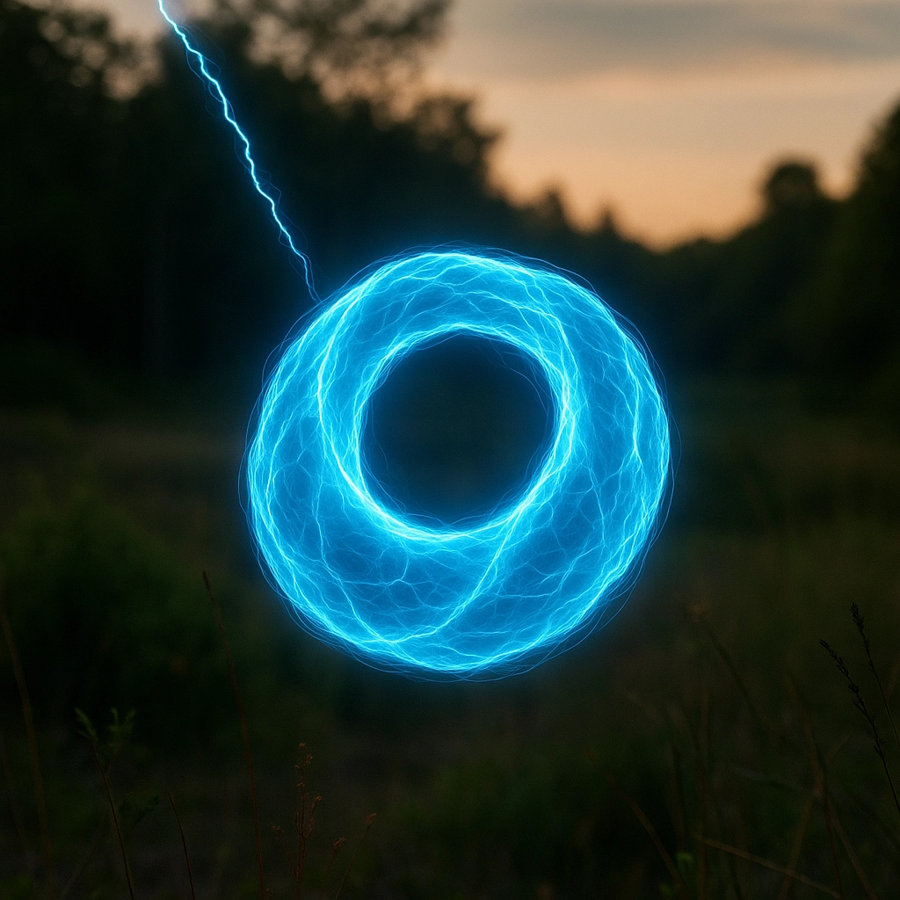

**[繁體中文版](./README-zh-TW.md)**

# Hopfion (Ring) Lightning Hypothesis

**霍普離子環閃電假說**

[](https://doi.org/10.5281/zenodo.17510337)

A theoretical hypothesis proposing that so-called "Ball Lightning" is a **Hopfion (Ring) Lightning** — a compact toroidal plasma structure whose magnetic field lines are linked (nonzero magnetic helicity), contained by the surrounding atmosphere's pressure. The observed round appearance is proposed to come from a thick luminous torus seen through its own glow.

> **v0.8 (2026-11-07) is a correction release.** A physics re-audit found that topology alone cannot explain multi-second lifetimes: at v0.7's reference temperature of ~4,200 K (not a measured value), air plasma's resistive decay time for a 10 cm structure is ~10⁻⁷ s, and a 5 s lifetime would need a conductivity above that of copper. This is now stated as the hypothesis's central open problem, alongside corrected formulas and self-consistent predictions. See [What Changed in v0.8](./markdown/en/hypothesis-en.md#what-changed-in-v08).

> This is a living document. Contributions, critiques, and falsification attempts are welcome.



---

## Author

**Kris Lai**
- Email: kriss@scallop.io
- ORCID: [0009-0000-2223-4826](https://orcid.org/0009-0000-2223-4826)
- Affiliation: [Scallop Labs](https://www.scallop.io/)

---

## Documents

| Document | Language | Description |
|----------|----------|-------------|
| [`hypothesis-en.md`](./markdown/en/hypothesis-en.md) | English | Full hypothesis framework in Markdown |
| [`hypothesis-zh-TW.md`](./markdown/zh-TW/hypothesis-zh-TW.md) | 繁體中文 | Full hypothesis framework in Traditional Chinese |
| [`VERIFICATION-REPORT.md`](./markdown/en/VERIFICATION-REPORT.md) | English | Scientific verification report |
| [`VERIFICATION-REPORT-zh-TW.md`](./markdown/zh-TW/VERIFICATION-REPORT-zh-TW.md) | 繁體中文 | Scientific verification report (Chinese) |

---

## Verification Summary

> **v0.8 note:** the v0.7 verification below checked references and textbook forms, but it passed several physics errors — a dimensionally wrong lifetime formula, a helicity/Hopf-charge normalization that does not apply to physical fields, a rotation prediction inconsistent with the predicted field, and the claim that topology alone confers stability. These are corrected in v0.8; the re-audit is in §0 of the [Verification Report](./markdown/en/VERIFICATION-REPORT.md), and the numerical checks are reproducible with the scripts in [`analysis/`](./analysis/).

The v0.7 verification (2026-03-12) reported:

| Category | Verified | Method |
|----------|----------|--------|
| Physics equations (MHD) | 3/3 | Textbook cross-reference |
| Topological claims | 5/5 | Peer-reviewed literature |
| Observational claims | 6/6 | Ball lightning survey data |
| Formation mechanism claims | 4/4 | Atmospheric physics literature |
| Hopfion experimental analogs | 4/4 | Condensed matter / optics literature |
| DOI references | 30/30 | CrossRef REST API |
| **Total verified claims** | **52** | |

> Full methodology, per-claim tables, and complete DOI audit results are documented in the [Verification Report](./markdown/en/VERIFICATION-REPORT.md).

---

## Structure Overview

- **Chapter 0 — Preface** — From lightning to a ring-shaped energy body
- **Chapter 1 — Redefining Ball Lightning** — The misread appearance, bubble ring analogy, core claim
- **Chapter 2 — Hopfion (Ring) Structure** — Helicity vs Hopf invariant; stability ingredients (atmospheric confinement)
- **Chapter 3 — Abstract** — Core hypothesis statement and topological invariant
- **Chapter 4 — Governing Equations** — MHD formulation for Hopfion (Ring) Lightning
- **Chapter 5 — Topological Features** — Self-closed ring loops, Hopf linking, toroidal core
- **Chapter 6 — Formation Mechanisms** — Lightning-triggered and spontaneous topological generation
- **Chapter 6A — Helicity Injection** *(v0.8)* — Where the helicity comes from; geomagnetic route quantified
- **Chapter 7 — Environmental Conditions** — Formation factor weights and thresholds (qualitative)
- **Chapter 8 — Lifetime** — Corrected lifetime formula τ ≈ E / P_loss
- **Chapter 8A — Quantitative Self-Consistency Checks** *(v0.8)* — Resistive decay, energy budget, rotation, spheromak comparison, status
- **Chapter 9 — Observational Correspondence** — Matching reported phenomena to the ring model, with open items marked
- **Chapter 10 — Falsifiable Predictions** — Self-consistent experimental signatures
- **Chapter 11 — Conclusion** — Scientific positioning and the open lifetime problem
- **Appendix A — Torus Projection Geometry** *(v0.8)* — When does a luminous torus look round?

---

## Key Equation

The core topological quantity (magnetic helicity, a flux-weighted count of how field lines link):

```
H_m = ∫ (A · B) d³r ≠ 0
```

When H_m ≠ 0 and the field is frozen into the plasma, magnetic field lines form linked configurations that cannot be undone without reconnection. That condition requires a large magnetic Reynolds number; whether atmospheric plasma can meet it for seconds is the open problem examined in Ch. 8A. (v0.7 wrote this as "Q_H", the integer Hopf charge; the two are not interchangeable for a physical magnetic field — see Ch. 2.2.)

---

## Co-Created With

This hypothesis was co-created with the assistance of AI models and tools:

**AI Models:**
- [Claude Sonnet 4.5](https://anthropic.com/) (Anthropic) — Theoretical Draft
- [GPT-5](https://openai.com/) (OpenAI) — Theoretical Review & Structural Integration
- [Claude Opus 4](https://anthropic.com/) (Anthropic) — Document Migration & Formatting
- [Claude Opus 5.5](https://anthropic.com/) (Anthropic) — v0.8 Physics Re-audit, Corrections & Quantitative Checks

**Tools:**
- [OpenClaw](https://github.com/openclaw/openclaw) — AI gateway & agent runtime
- [Claude Code](https://claude.ai/claude-code) — Anthropic's agentic coding tool

---

## License

This work is licensed under the [Creative Commons Attribution 4.0 International License (CC BY 4.0)](https://creativecommons.org/licenses/by/4.0/).

You are free to share and adapt this work, provided appropriate credit is given.
